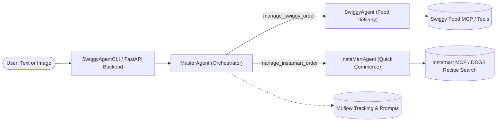
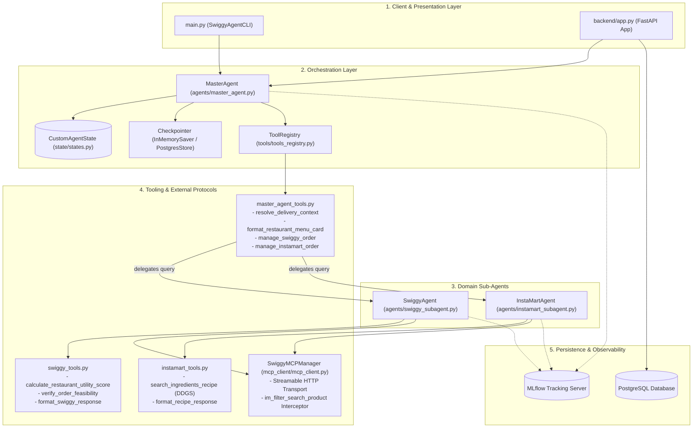
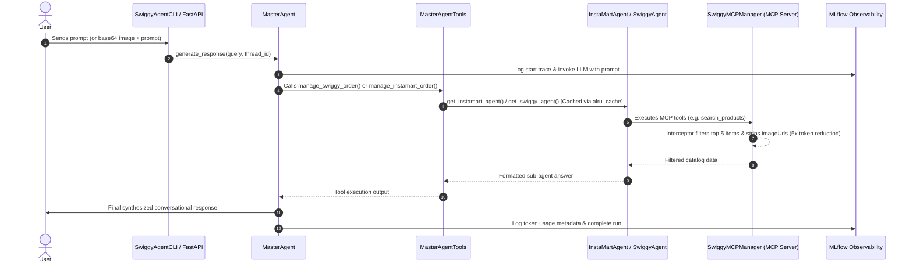

# System Architecture: Agent Chhotu 

Welcome to the **Agent Chhotu** repository. This document is structured across **four progressive levels of verbosity** so that any engineer—whether reading for 60 seconds or conducting a deep code walkthrough—can rapidly understand the design decisions, component lifecycles, and implementation mechanics.

---

## Table of Contents
1. [Level 1: The Birds-Eye View (60-Second Onboarding)](#level-1-the-10000-ft-view-60-second-onboarding)
2. [Level 2: System Architecture & Ecosystem Topology (5-Minute Onboarding)](#level-2-system-architecture--ecosystem-topology-5-minute-onboarding)
3. [Level 3: Deep Dive — State Machines, Agents & Interceptors (15-Minute Onboarding)](#level-3-deep-dive--state-machines-agents--interceptors-15-minute-onboarding)
4. [Level 4: Codebase Walkthrough & Developer Implementation Guide (30-Minute Onboarding)](#level-4-codebase-walkthrough--developer-implementation-guide-30-minute-onboarding)

---

## Level 1: The Birds-Eye View (60-Second Onboarding)

### What is this project?
**Agent Chhotu** (internally referred to as **Agent Chhotu**) is a multimodal, hierarchical multi-agent conversational commerce assistant. It acts as a smart concierge across food delivery and quick-commerce grocery shopping.

Users can converse via text or upload images of dishes. The system determines the user's culinary intent:
- **"Order In" (Swiggy Food)**: Recommends restaurants, inspects menus, calculates multi-criteria utility scores (rating, delivery time, price), checks order constraints, and verifies delivery addresses.
- **"Cook at Home" (Swiggy Instamart)**: Deconstructs the dish into recipes and ingredients, queries Instamart dark stores via Model Context Protocol (MCP), prunes product search bloat, and stages carts.



### Core Tech Stack
| Component | Technology | Purpose |
| :--- | :--- | :--- |
| **Language & Runtime** | Python 3.13, Astral `uv` | High-performance execution, modern typing, fast dependency resolution |
| **Agent Framework** | LangChain 1.2+, LangGraph 1.1+ | Graph-based state machine, agent executors, tool nodes, checkpointers |
| **Models & Providers** | Google GenAI (Gemini), OpenAI, Anthropic, Ollama, HuggingFace | Multi-provider LLM abstraction via [`ModelProvider`](schema/model_provider.py) |
| **Protocol Integration** | Model Context Protocol (`langchain-mcp-adapters`) | Live tool discovery for catalog searching and cart management |
| **Observability & Prompt Ops** | MLflow (`mlflow.langchain.autolog()`, `mlflow.genai`) | Trace logging, token usage callback tracking, centralized prompt registry |
| **Persistence** | PostgreSQL (`asyncpg`, `SQLAlchemy`), `InMemorySaver` | Chat sessions, messages, and graph thread checkpoints |

---

## Level 2: System Architecture & Ecosystem Topology (5-Minute Onboarding)

The system follows a **Hierarchical Supervisor Multi-Agent Pattern**. The [`MasterAgent`](agents/master_agent.py) acts as a top-level orchestrator that delegates specialized tasks to isolated sub-agents ([`SwiggyAgent`](agents/swiggy_subagent.py) and [`InstaMartAgent`](agents/instamart_subagent.py)) via LangChain tools.

### High-Level Component Topology



### End-to-End Execution Sequence



---

## Level 3: Deep Dive — State Machines, Agents & Interceptors (15-Minute Onboarding)

### 1. State Management: [`CustomAgentState`](state/states.py)
The state represents the single source of truth across turns. It supports message accumulation, domain extraction, and Human-In-The-Loop (HITL) checkpoints:

- **Conversation Stream**: `messages: Annotated[List[BaseMessage], operator.add]` (appends message deltas automatically).
- **Culinary Deconstruction**: [`IdentifiedFood`](state/states.py) tracks `dish_name`, `components` (ingredients), `is_food` boolean, and `description`.
- **Fulfillment Logistics**: [`DeliveryContext`](state/states.py) maintains `address_id`, `address_label` (e.g., "Home", "Work"), `full_address`, and `is_verified`.
- **E-Commerce Staging**: `instamart_prod: list[ProductInfo]` holds `spin_id`, `name`, `price`, `quantity`, and dark `store_id`.
- **HITL Flow Control**: `pending_confirmation: bool` allows the graph to pause execution until the user selects or approves cart items.

### 2. The Abstract Agent Foundation: [`BaseAgent`](agents/base_agent.py)
All agents inherit from `BaseAgent`, enforcing uniform behavior:
- **Model Agnostic Initialization**: [`init_model`](agents/base_agent.py#L65-L107) standardizes parameters (`temperature=0.7`, `top_p=0.9`, `seed=42`, `max_retries=3`, `max_tokens`) using LangChain's `init_chat_model`.
- **Dynamic Tool Binding**: [`get_tools`](agents/base_agent.py#L133-L147) fetches permitted tools from [`ToolRegistry`](tools/tools_registry.py).
- **Asynchronous Streaming**: [`generate_response`](agents/base_agent.py#L149-L179) iterates over the agent graph's `astream()`, inspects `AIMessage` chunks, logs usage metadata, and outputs results.

### 3. Model Context Protocol (MCP) & Token Pruning Interceptor
The MCP client in [`SwiggyMCPManager`](mcp_client/mcp_client.py) connects over Streamable HTTP (`MCP_TRANSPORT`). Raw quick-commerce search results can return dozens of bulky product variations with large nested image URLs, leading to prompt bloat and token exhaust.

To prevent this, the [`im_filter_search_product`](mcp_client/mcp_client.py#L34-L70) interceptor intercepts `search_products` calls on the fly:
1. Intercepts downstream tool results before they hit the agent's context window.
2. Slices catalog items to the **top 5 products**.
3. Deletes heavy fields (e.g., `imageUrl`) from all variation payloads.
4. Serializes the compacted JSON back to the message content, **reducing token consumption by 5x to 10x**.

### 4. Multi-Criteria Restaurant Utility Scoring
When evaluating restaurants, [`calculate_restaurant_utility_score`](tools/swiggy_tools.py#L8-L42) calculates a normalized multi-criteria objective function:

$$\text{Utility Score} = (0.5 \times S_{\text{rating}}) + (0.3 \times S_{\text{time}}) + (0.2 \times S_{\text{price}})$$

Where:
- $S_{\text{rating}} = \frac{\text{rating}}{5.0}$
- $S_{\text{time}} = 1 - \frac{\min(\text{delivery\_time}, 60)}{60}$ (faster delivery yields higher score)
- $S_{\text{price}} = 1 - \frac{\min(\text{avg\_price}, 1000)}{1000}$ (cheaper price yields higher score)

The tool then ranks the candidate restaurants and returns the top 5 highest-utility venues.

### 5. Memory Caching for Agent Instances
Instantiating agents and compiling LangGraph graphs repeatedly can introduce latency. The factory functions [`get_swiggy_agent`](agents/swiggy_subagent.py#L112-L128) and [`get_instamart_agent`](agents/instamart_subagent.py#L114-L130) utilize `@alru_cache(maxsize=1)`. 

Because dictionary arguments are unhashable in Python caches, the [`deep_make_hashable`](utils/common.py#L7-L22) and [`deep_make_dict`](utils/common.py#L24-L39) utilities recursively convert unhashable dicts into `frozenset` tuples for memoization, then re-hydrate them upon construction.

---

## Level 4: Codebase Walkthrough & Developer Implementation Guide (30-Minute Onboarding)

### Directory Structure & Responsibilities

```
swiggy_builder_agents/
├── agents/                       # Agent classes & lifecycle orchestration
│   ├── base_agent.py             # BaseAgent & BaseStructuredAgent abstract classes
│   ├── master_agent.py           # MasterAgent supervisor implementation
│   ├── swiggy_subagent.py        # Swiggy Food delivery sub-agent
│   ├── instamart_subagent.py     # Instamart grocery sub-agent
│   └── middleware/
│       └── middlewares.py        # LangChain agent model call middlewares (e.g., get_state)
├── backend/                      # Web API service
│   ├── app.py                    # FastAPI application with session & chat endpoints
│   └── database.py               # SQLAlchemy async PostgreSQL engine & models
├── mcp_client/                   # Model Context Protocol integration
│   ├── auth.py                   # Browser OAuth / authentication flow
│   └── mcp_client.py             # SwiggyMCPManager client & response interceptors
├── prompts/                      # Centralized prompts loaded from MLflow
│   ├── master_agent_prompt.py    # Master supervisor prompt loader
│   ├── swiggy_subagent_prompt.py # Swiggy Food persona prompt loader
│   └── instamart_subagent_prompt.py # Instamart persona prompt loader
├── schema/                       # Enums and contract definitions
│   ├── agent_type.py             # AgentType (MASTER, SWIGGY, INSTAMART)
│   └── model_provider.py         # ModelProvider enum (GOOGLE, OPENAI, ANTHROPIC, etc.)
├── state/                        # State schemas for LangGraph
│   └── states.py                 # CustomAgentState, IdentifiedFood, DeliveryContext, ProductInfo
├── tools/                        # Functional capabilities exposed to agents
│   ├── tools_registry.py         # Central ToolRegistry mapping agents to toolsets
│   ├── master_agent_tools.py     # Delegation tools (manage_swiggy_order, manage_instamart_order)
│   ├── swiggy_tools.py           # Restaurant utility scoring & order feasibility checks
│   └── instamart_tools.py        # Recipe search via DuckDuckGoSearchRun
├── utils/                        # Shared utility functions
│   ├── common.py                 # deep_make_hashable, deep_make_dict, get_db_uri
│   └── logger.py                 # Structured application logging
├── main.py                       # Interactive CLI entry point (SwiggyAgentCLI)
├── Dockerfile                    # Multi-stage production container build (Astral uv + Python 3.13)
├── .dockerignore                 # Image build context exclusions
└── pyproject.toml                # Project metadata and dependencies
```

---

### Step-by-Step Developer Guides

#### 1. How to Add a New Tool
1. Define the tool function in the appropriate file in `tools/` (e.g. [`tools/swiggy_tools.py`](tools/swiggy_tools.py)) using LangChain's `@tool` decorator:
   ```python
   from langchain.tools import tool

   @tool
   def check_swiggy_coupon(coupon_code: str, cart_value: float) -> dict:
       """Applies and verifies a promotional discount code."""
       # Logic here
       return {"valid": True, "discount": 50.0}
   ```
2. Register the tool inside [`ToolRegistry.REGISTRY`](tools/tools_registry.py#L21-L33):
   ```python
   # In tools/tools_registry.py
   from tools.swiggy_tools import check_swiggy_coupon

   REGISTRY = {
       AgentType.SWIGGY: [
           verify_order_feasibility,
           format_swiggy_response,
           check_swiggy_coupon,  # <-- Added here
       ],
       ...
   }
   ```

#### 2. How to Add a New Sub-Agent
1. Add an identifier in [`AgentType`](schema/agent_type.py):
   ```python
   class AgentType(Enum):
       INSTAMART = "instamart"
       MASTER = "master"
       SWIGGY = "swiggy"
       DINEOUT = "dineout"  # <-- New agent
   ```
2. Create `agents/dineout_subagent.py` subclassing [`BaseAgent`](agents/base_agent.py).
3. Create a delegation tool in [`tools/master_agent_tools.py`](tools/master_agent_tools.py) decorated with `@tool` (e.g., `manage_dineout_booking(request: str)`).
4. Register the delegation tool under `AgentType.MASTER` in [`ToolRegistry`](tools/tools_registry.py).

#### 3. How to Switch LLM Providers
Set the provider and model via environment variables in `.env`:
```bash
# To use Google Gemini:
MASTER_AGENT_MODEL=gemini-2.0-flash
MASTER_AGENT_MODEL_PROVIDER=google_genai
GOOGLE_API_KEY=your_key_here

# To switch to OpenAI:
# MASTER_AGENT_MODEL=gpt-4o
# MASTER_AGENT_MODEL_PROVIDER=openai
# OPENAI_API_KEY=your_key_here
```
The [`ModelProvider`](schema/model_provider.py) enum routes provider names cleanly to LangChain's `init_chat_model`.

---

### Common Gotchas & Troubleshooting

> [!WARNING]
> **1. MLflow Prompt Registry Dependency**: The prompt files in `prompts/` call `mlflow.genai.load_prompt(...)`. If your MLflow server is offline or the prompt name is not yet registered in MLflow, starting the agent will fail. Ensure `MLFLOW_TRACKING_URI` is reachable or provide local fallback prompt strings.

> [!NOTE]
> **2. MCP Server Authentication**: If Swiggy MCP tools fail with HTTP 401/403, verify that `MCP_ACCESS_TOKEN` is set in `.env` or use [`SwiggyMCPManager.update_token(new_token)`](mcp_client/mcp_client.py#L155-L165).

> [!TIP]
> **3. Running the Application**:
> - **Interactive CLI**: `python main.py`
> - **Backend API**: `uvicorn backend.app:app --host 0.0.0.0 --port 8000 --reload`
> - **Docker Container**: `docker build -t swiggy-agent . && docker run -it --env-file .env swiggy-agent`

